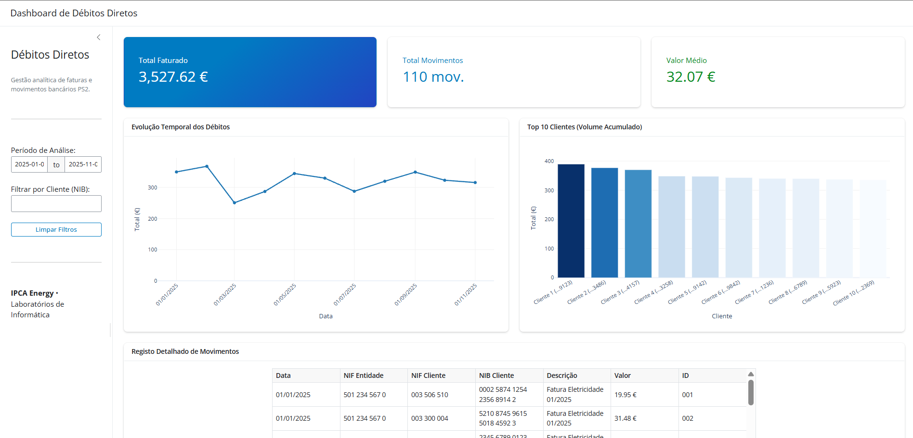

# Direct Debit Dashboard (PS2)

<p align="left">
  
  
  
  
  
  
</p>

> **Course:** Computer Science Laboratories  
> **Degree:** B.Sc. in Computer Systems Engineering (*Daytime Program*) — Academic Year 2025/2026  
> **Institution:** Polytechnic University of Cávado and Ave (UPCA)

---

## Table of Contents

- [Overview](#overview)
- [Key Features](#key-features)
- [Repository Structure](#repository-structure)
- [Tech Stack](#tech-stack)
- [Installation and Usage](#installation-and-usage)
- [PS2 Format Specification](#ps2-format-specification)
- [Demo](#demo)
- [Development Team (Group 43)](#development-team-group-43)
- [References](#references)

---

## Overview

The **Direct Debit Dashboard** is a software solution built to parse, validate, and visualize monthly bank direct debit batches in the proprietary **PS2** format used by *IPCA Energy*.

The application bridges raw fixed-width banking files and an interactive analytics interface powered by **Shiny for Python**, enabling finance teams to monitor high-level KPIs, audit customer transactions, and analyze settlement trends in real time.

---

## Key Features

- **PS2 File Parser:** Automated positional data extraction from bank batch files (headers, transaction records, and control footers).
- **Data Processing and Normalization:**
  - Exact splitting of the 30-character customer identifier into a **9-digit Tax ID (NIF)** and a **21-digit Bank Account Number (NIB)**;
  - Conversion of monetary values from integer cents to decimal euros;
  - Date resolution based on the file identifier with built-in consistency validation.
- **Interactive and Reactive Dashboard:**
  - **Dynamic Filters:** Flexible date range selection and targeted filtering by customer (NIB);
  - **Executive KPIs:** Cumulative financial volume and total transaction count for the selected period;
  - **Time-Series Chart:** Interactive timeline with data markers and currency formatting (Plotly);
  - **Top Customers by Spend:** Ranked bar chart highlighting the highest cumulative direct debits;
  - **Detailed Data Table:** Paginated, chronologically sorted grid with formatted spacing for readable NIF and NIB inspection.

---

## Repository Structure

The project follows a clean, modular structure:

```text
d-43/
├── assets/
│   └── img/
│       └── DashboardDebitos.png   # Dashboard screenshots and visual assets
├── data/                          # Input data (monthly batches in PS2 format)
│   ├── DD_2025_01.ps2
│   └── ...
├── doc/                           # Academic documentation and LaTeX report
│   ├── capas/
│   │   └── capa.tex
│   ├── capitulos/
│   │   ├── 01_introducao.tex
│   │   ├── 02_desenvolvimento.tex
│   │   └── 03_conclusao.tex
│   ├── d43-main.pdf               # Compiled final report
│   └── d43-main.tex               # Main LaTeX entry file
├── ref/                           # Technical code documentation generated by Doxygen
│   ├── Doxyfile                   # Doxygen configuration file
│   ├── html/                      # HTML documentation output
│   └── latex/                     # LaTeX documentation output
├── src/                           # Application source code
│   ├── app.py                     # Reactive web application and dashboard (Shiny)
│   └── parser.py                  # PS2 file reading and parsing module
├── .gitignore                     # Git ignore rules
├── Makefile                       # Task automation (install, run, and clean)
├── planeamento.md                 # Weekly planning and task allocation
├── README.md                      # Main repository documentation
└── requirements.txt               # Python project dependencies
```

---

## Tech Stack

| Technology | Purpose |
| :--- | :--- |
| **Python 3.10+** | Core programming language |
| **Shiny for Python** | Reactive web application framework |
| **Pandas** | Tabular data manipulation, cleaning, and aggregation |
| **Plotly Express** | Interactive analytical charts and visualizations |
| **LaTeX / BibLaTeX** | Technical and academic report authoring |
| **Doxygen** | Automated documentation generation from source docstrings |
| **Make** | Build, installation, and execution workflow automation |

---

## Installation and Usage

### Prerequisites
- Python 3.10 or higher
- `pip` package manager

### 1. Clone the Repository
```bash
git clone [https://github.com/IPCALESI2526/d-43.git](https://github.com/IPCALESI2526/d-43.git)
cd d-43
```

### 2. Create and Activate a Virtual Environment (Recommended)
```bash
# On Linux/macOS:
python3 -m venv venv
source venv/bin/activate

# On Windows (PowerShell):
python -m venv venv
.\venv\Scripts\Activate.ps1
```

### 3. Install Dependencies
Using the `Makefile`:
```bash
make install
```
Or directly via `pip`:
```bash
pip install -r requirements.txt
```

### 4. Start the Application
Using the `Makefile`:
```bash
make run
```
Or directly with the Shiny CLI:
```bash
shiny run src/app.py
```

Open the application in your browser at the local address displayed in the terminal (typically `http://127.0.0.1:8000`).

---

## PS2 Format Specification

The files in the `data/` directory represent direct debit transmissions structured as fixed-width positional records:

| Record Type | Position | Field | Description |
| :---: | :---: | :--- | :--- |
| **1 (Header)** | `01-09` | Internal Date | File creation date (`YYYYMMDD`) |
| | `10-52` | Creditor Name | Name of the billing entity (e.g., `IPCA Energy`) |
| | `53-62` | Entity Tax ID (NIF) | Tax identification number of the creditor entity |
| | `63-75` | Total Amount | Cumulative batch amount (in cents) |
| | `76-81` | Record Count | Total number of transactions in the batch |
| **2 (Transaction)** | `09-11` | Sequence ID | Sequential record number within the batch |
| | `12-20` | Customer NIF | First 9 characters of the customer identifier field |
| | `21-41` | Customer NIB | Remaining 21 characters of the customer identifier field |
| | `42-55` | Amount | Debit amount (in cents) |
| | `56-82` | Description | Debit reference/reason (e.g., `Fatura Eletricidade 07/2025`) |
| **9 (Footer)** | `02-15` | Total Amount | Batch verification checksum total (in cents) |
| | `16-21` | Record Count | Final transaction count for batch auditing |

### Sample File (`DD_2025_07.ps2`)
```text
120250726IPCA Energy                                50123456700000000028779000010
2000000100100350651000025874125423568914200000000002136Fatura Eletricidade 07/2025
2000000100200330000452108745961550184592300000000004561Fatura Eletricidade 07/2025
2000000100300100000123456789012312345678900000000002063Fatura Eletricidade 07/2025
2000000100400360010234567890123429845123600000000002860Fatura Eletricidade 07/2025
2000000100500230099887766554433245678912300000000004507Fatura Eletricidade 07/2025
2000000100600380011223344556677887451236900000000002208Fatura Eletricidade 07/2025
2000000100700190055667788990011215975348600000000002208Fatura Eletricidade 07/2025
2000000100800420066554433221100995175325800000000002661Fatura Eletricidade 07/2025
2000000100900330012312312312312375315984200000000003077Fatura Eletricidade 07/2025
2000000101000110099880077665544362839415700000000002498Fatura Eletricidade 07/2025
900000000028779000010
```

---

## Demo

<div align="center">
  
  <p><em>Figure: Interactive Shiny for Python interface featuring date and NIB filters alongside analytical charts.</em></p>
</div>

---

## Development Team (Group 43)

| Planning Role | Student ID | Name |
| :---: | :---: | :--- |
| **A1** | `29330` | Edgar Brito |
| **A2** | `29328` | Tiago Lima |
| **A3** | `29333` | Rui Araújo |
| **A4** | `29325` | Henrique Ribeiro |

See [planeamento.md](./planeamento.md) for weekly branch schedules, commit history, and individual task breakdowns.

---

## References

- [Shiny for Python Documentation](https://shiny.posit.co/py/)
- [Pandas User Guide](https://pandas.pydata.org/docs/)
- [Plotly Python Documentation](https://plotly.com/python/)
- [Doxygen Official Manual](https://www.doxygen.nl/manual/)
- [gitignore.io](https://www.toptal.com/developers/gitignore)
